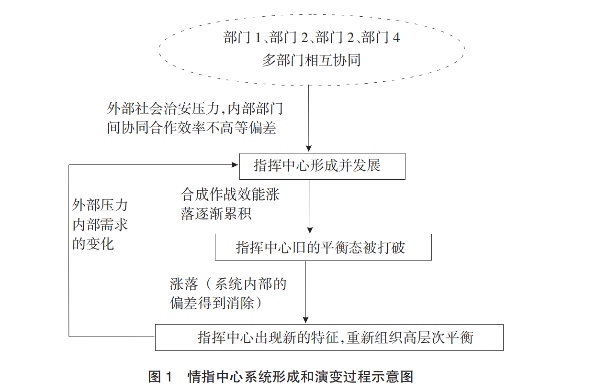
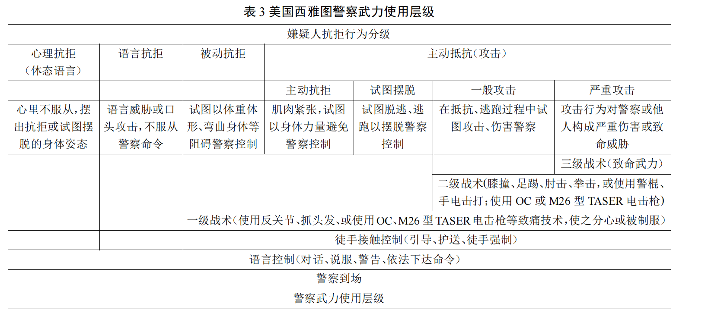
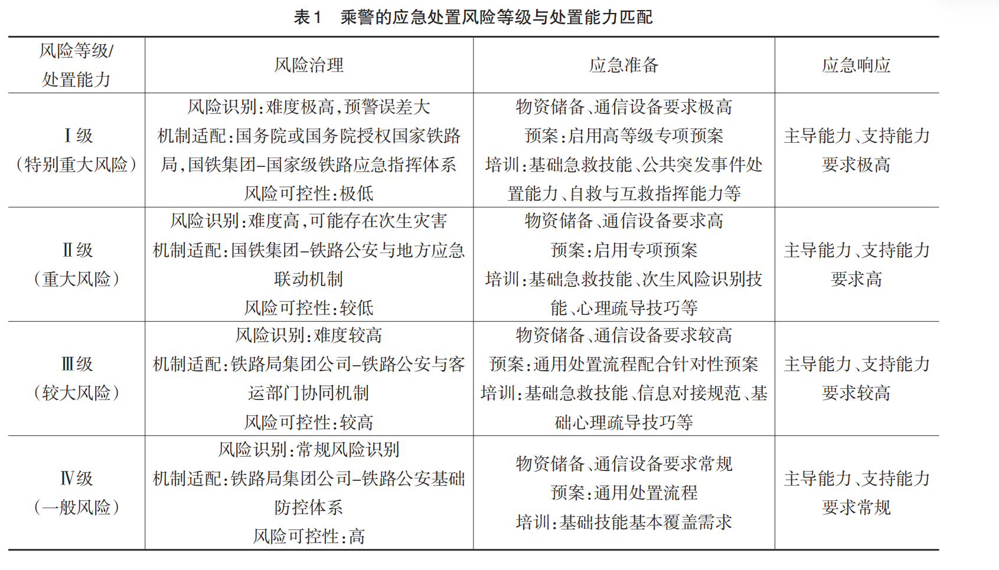
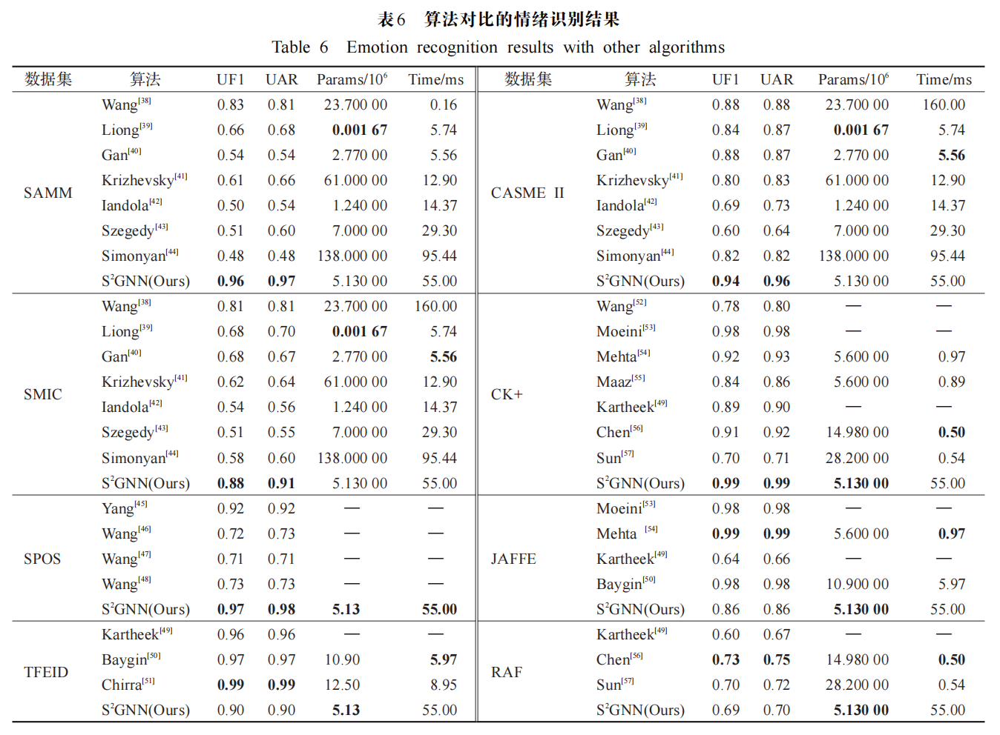
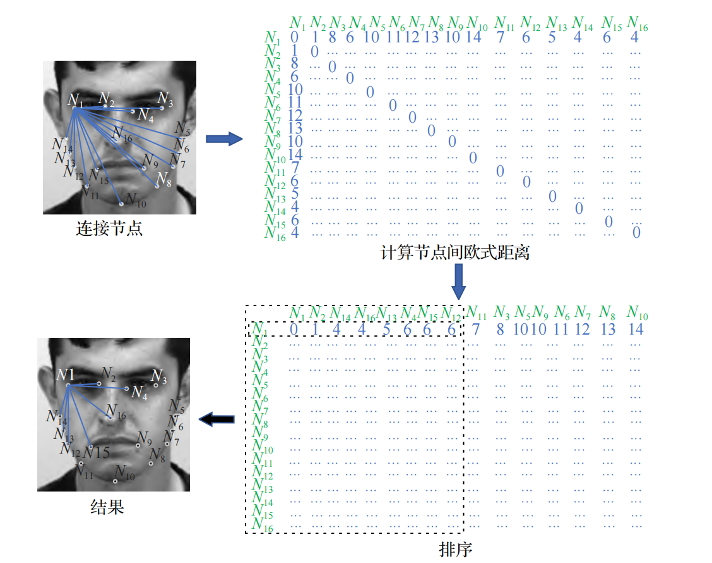
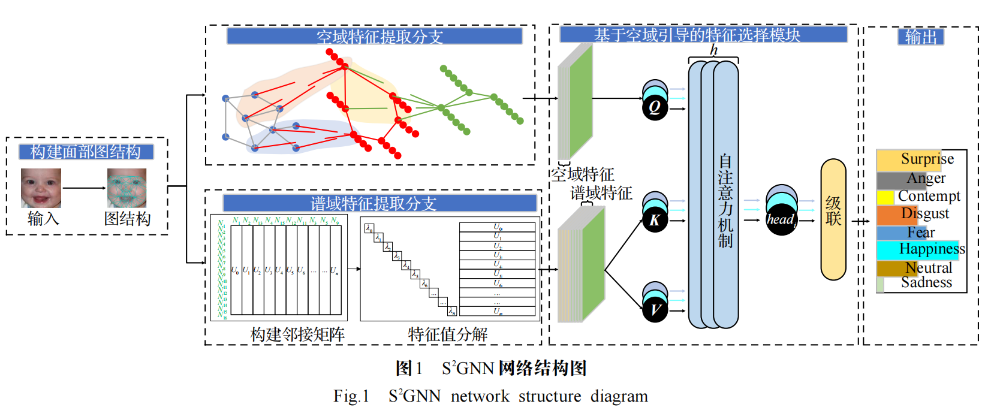

## Introdution
The project leverages the long-established hardware and software training environment of the "Public Security University Municipal Simulation Police Bureau" at our university, specifically targeting on-campus police students and in-service officers engaged in police command.  
1. It involves the development of a police commander simulation training system, including subsystems such as incident handling, visual dispatching, case analysis and assessment, and AVAYA communication. Additionally, it encompasses the deployment, setup, and debugging of these systems along with the simulated training teaching environment. Three software patents were applied for, innovatively addressing the training simulation environment challenges for commanders at all levels.  
2.  It includes modeling a technical prototype based on a desktop virtual reality system (integrating applications like Skyworth VR一体机 and NOLO six-degree-of-freedom VR interactive kits). Two computer software copyright registration certificates were applied for. Research proposed a personalized learning model for police commanders supported by knowledge graphs, innovatively solving the simulation training for field commanders.  
3.  Two monographs were published, and four papers were published in CSSCI core journals.

## Overview

- **Motivation:** Modern policing faces challenges in large-event traffic command, fragmented “Intelligence–Command–Action” coordination, railway water-damage emergencies, unclear use-of-force discretion, and expression recognition with limited data.

- **Methods:** The studies use case analysis, theoretical modeling, and algorithm design: a “1+3+N” traffic command model, synergetic analysis of ICA reform, the K396 incident, a force-discretion model, and the S³GNN graph neural network.

- **Outcomes:** They provide integrated command frameworks, improved inter-agency coordination, emergency countermeasures, a dynamic discretion model for force, and S³GNN achieving 89.11% accuracy with strong limited-data performance.

The works reviewed here address intelligent policing, integrated command, emergency response, and law enforcement discretion. He et al. propose a “1+3+N” traffic command model for large-scale events, combining “Intelligence–Command–Action” integration with contingency planning, rapid response, and AI empowerment. Mo and He apply synergetics to ICA reform, identifying weak cooperation, unclear command authority, and incomplete social linkage. You and He analyze train police response to the K396 water-damage incident, highlighting gaps in risk identification, information symmetry, legal authorization, and cross-departmental coordination. Yong and He construct a discretion model for police use of force, integrating situational factors, danger assessment, and de-escalation. Zhang et al. develop S³GNN, a graph neural network fusing spatial and spectral features for facial expression recognition, achieving 89.11% average accuracy and strong performance with limited data. Together, these works link organizational reform, frontline discretion, emergency response, and AI-enabled perception, offering an integrated agenda for modern policing.

- **Examples of the main figures and tables in the article**

## Results
Training based on the "Police Commander Simulation Training System" serves as a software complement to the hardware construction of our school's practical training facilities, playing a leading and exemplary role. The two monographs and multiple papers published under this project represent the theoretical forefront in the field of vocational education, addressing key theoretical issues in police commander training.
`.