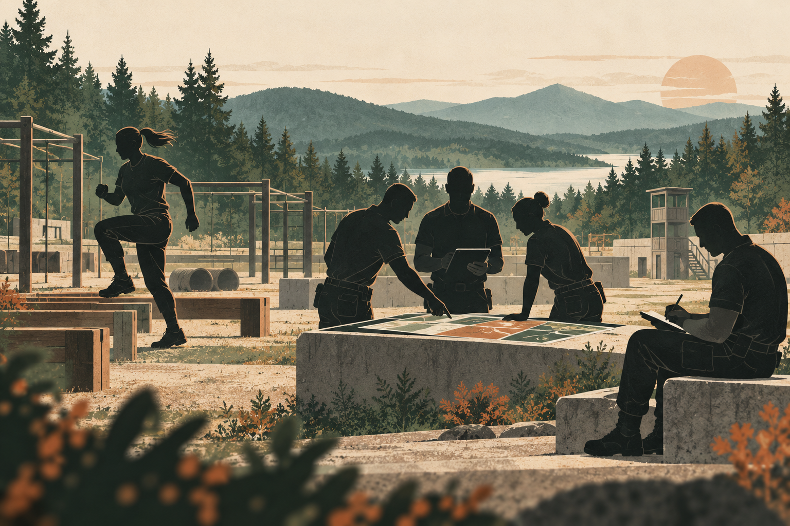

## Overview

Police Training Practice is a research and practice stream focused on the capabilities required for safe, lawful, and effective police operations. It connects physical skills, tactical decision-making, instructor development, scenario-based practice, and the continuous improvement of training programs.

The project is grounded in a practical problem: police training must respond to changing operational risks, while many of the most important skills come from real cases and the experience of frontline officers. The project therefore treats training as an iterative process in which operational experience is collected, reflected upon, organized, tested, and turned into teachable resources.

<link rel="stylesheet" href="police-training.css">
<section class="training-pathway" data-training-pathway aria-labelledby="training-pathway-title">
  

    

Interactive training map · 01—04
<h3 id="training-pathway-title">From Foundations to Continuous Improvement</h3>

    
Select a node to explore the training focus, or use the arrow keys.

  

  

    <button type="button" role="tab" aria-selected="true" data-training-tab="0">01 · Foundations</button>
    <button type="button" role="tab" aria-selected="false" tabindex="-1" data-training-tab="1">02 · Tactics</button>
    <button type="button" role="tab" aria-selected="false" tabindex="-1" data-training-tab="2">03 · Command</button>
    <button type="button" role="tab" aria-selected="false" tabindex="-1" data-training-tab="3">04 · Review</button>
  

  

    
01

    
<h4 data-training-title>Physical and Technical Foundations</h4>
Build consistent conditioning, movement quality, basic first aid, and equipment handling around real operational tasks.

Fitness assessmentMovement and controlSafety fundamentals

  

  

  
01 / 04<button type="button" data-training-next>Next node&nbsp; →</button>

</section>

<figure class="training-figure">
  
  <figcaption>Training as a connected cycle: physical foundations, coordinated action, and structured review.</figcaption>
</figure>

## Training Domains

The project develops an integrated view of police operational capability rather than treating individual skills as isolated courses.

- **Physical and technical skills**: fitness, defensive skills, equipment use, movement, first response, and other foundational abilities.
- **Firearms and tactical practice**: safe firearm handling, tactical shooting, decision-making under pressure, and the relationship between technical proficiency and lawful use of force.
- **Operational command and coordination**: information collection, risk assessment, task allocation, communication, and coordination among teams and agencies.
- **Scenario-based response**: training built around realistic incidents, including public events, emergencies, transport incidents, and other complex situations.
- **Review and transfer**: after-action review, experience sharing, evidence collection, and the transfer of lessons into future training and operational guidance.

<section class="scenario-lab" data-scenario-lab aria-labelledby="scenario-lab-title">
  

Scenario lab · choose a case
<h3 id="scenario-lab-title">Scenario Task Selector</h3>

Select a scenario to see what it trains and which capabilities it can develop.

  

    <button class="scenario-lab__choice" type="button" role="tab" aria-selected="true" data-scenario-choice="0">01<strong>Field enforcement</strong><small>Decision-making and proportionality</small></button>
    <button class="scenario-lab__choice" type="button" role="tab" aria-selected="false" data-scenario-choice="1">02<strong>Major events</strong><small>Traffic and public-order management</small></button>
    <button class="scenario-lab__choice" type="button" role="tab" aria-selected="false" data-scenario-choice="2">03<strong>Railway emergency response</strong><small>Risk and coordinated response</small></button>
  

  

<h4 data-scenario-title>Field enforcement and use-of-force decisions</h4>
Design decision exercises around field information, communication, proportionality, and after-action records.

<strong>Observable training outcomes</strong>

Information judgmentDe-escalation communicationProportionality

</section>

## Instructor Development

Instructors are a central part of the training system. The research materials describe professional instructors as practitioners who need more than operational experience: they also need curriculum design, assessment, communication, reflection, and digital teaching capabilities.

The project therefore examines instructor development through four connected questions:

1. What professional knowledge and operational experience should an instructor possess?
2. How can instructors translate field experience into clear learning objectives and practical exercises?
3. How should training performance be observed, assessed, and improved?
4. How can digital tools, online resources, virtual simulation, and generative AI support instructors without replacing professional judgment?

A long-term goal is to develop a professional learning community in which instructors share cases, update training resources, and improve courses through repeated practice and review.

## Practice Oriented Curriculum Development

The project draws on research into practice-generated curricula and connectivist learning. In this approach, a training course is not treated as a fixed collection of textbook knowledge. It is developed through a cycle of:

1. identifying an operational problem;
2. collecting cases, experience, regulations, and other relevant information;
3. organizing the information into a preliminary learning task;
4. discussing and testing the task with practitioners and learners;
5. reflecting on the results;
6. revising the resources and training design.

This approach is useful for police training because operational conditions, technologies, and risks continue to change. It also makes the experience of frontline officers a source of curriculum knowledge while retaining the need for professional review and lawful practice.

## Digital and Intelligent Support

Digital tools can support police training in several ways. Knowledge graphs can help operational commanders identify gaps in their knowledge and connect concepts, procedures, roles, and cases. Online learning platforms can support resource sharing and collaborative reflection. Virtual or simulated environments can provide repeatable practice for complex situations. Data-based assessment can help instructors identify different learning needs.

These tools should support, rather than replace, professional instruction. Training design must continue to address legality, ethics, safety, privacy, reliability, and the limits of automated recommendations.

## Scenario Based Practice

The research materials provide several types of cases that can be used to organize future training modules:

- **Field enforcement and use-of-force decisions**: decision-making and proportionality in dynamic law-enforcement situations;
- **Major-event traffic and public-order management**: planning, command, communication, and coordination in large public events;
- **Railway emergency incident response**: risk identification, passenger protection, order maintenance, information reporting, resource coordination, and post-incident review;
- **Operational command and coordinated response**: the relationship between information, command decisions, team tasks, and frontline execution.

Each case module should describe the situation, the operational risks, the responsibilities of each role, the key decisions, the coordination process, and the lessons for future training. Specific case details should only be published after the team confirms that they are suitable for public release.

## Research Outputs

The project draws on the following research materials. The list is organized by contribution to the training system; publication metadata and external links can be added after the team confirms the public versions.

<section class="research-filter" data-research-filter aria-labelledby="research-filter-title">
  
<h3 id="research-filter-title">Research Output Explorer</h3>10 outputs

  

    <button type="button" aria-pressed="true" data-research-category="all">All</button><button type="button" aria-pressed="false" data-research-category="instructor">Instructors and curriculum</button><button type="button" aria-pressed="false" data-research-category="command">Command and learning</button><button type="button" aria-pressed="false" data-research-category="scenario">Scenarios and emergency response</button>
  

  

    
Professional development pathways for police operational instructors

Practice-generated curriculum models and vocational training resources

Digital literacy pathways for police operational instructors

    
Knowledge-graph-based personalized learning for police operational commanders

Flat command dispatch and the generation of new police capabilities

Reforming police operating mechanisms in the digital era

    
A discretionary model for police use of force in field-enforcement scenarios

Train-police emergency response to railway flooding

Traffic command and dispatch systems for major events

Applying large language models to field enforcement

  

</section>

### Instructor development and training resources

- He Fu-gang，“Professional development pathways for police operational instructors”:examines the professional role, competency structure, and development path of police operational instructors.
- Li Haoyu, “Digital literacy pathways for police operational instructors in the era of educational digital transformation and GAI”: discusses digital awareness, digital teaching practice, assessment, and institutional support for instructors.
- He Fu-gang，“Designing practice-generated curriculum models in an Internet-plus environment”:uses design-based research to develop practice-generated training courses from frontline experience.
- He Fu-gang，“Building practice-generated curriculum models through connectivism”:provides a learning and curriculum framework for connecting practitioners, cases, resources, and collaborative knowledge building.
- He Fu-gang，“Techniques for generating curriculum resources from a connectivist perspective”:supports the technical organization of continuously updated practice-based learning resources.
- He Fu-gang，“Methods for developing curriculum resources in vocational training”:offers methods for turning workplace experience into usable vocational training resources.

### Operational command and personalized learning

- He Fu-gang, Zhou Sijia, and Lin Hao, “Knowledge-graph-based personalized learning for police operational commanders”: explores knowledge graphs, knowledge supplementation, machine language cognition, and reasoning support for operational commanders.
- He Fu-gang, “The evolution of flat command dispatch and new police capabilities”: examines how command structure and dispatch mechanisms affect operational capability.
- He Fu-gang, “Traffic command and dispatch mechanisms for major events”: provides a scenario for studying planning, communication, task allocation, and multi-party coordination.
- Ma Boyang，“Reforming police operating mechanisms in the digital era”:offers a broader institutional context for digital and coordinated police operations.

### Scenario based practice and operational response

- Yong Zexuan, “Constructing a police use-of-force discretion model for field-enforcement scenarios”: supports scenario design around lawful, necessary, and proportionate use-of-force decisions.
- You Zhenrong and He Fu-gang, “Train-police emergency response during the K396 railway flooding delay”: shows how risk identification, passenger protection, order maintenance, information reporting, resource coordination, and after-action review can be organized into a training case.
- Research on traffic command and dispatch for major events: supports exercises in event planning, traffic organization, command communication, and emergency coordination.
- Research on police operational instructors and practice-based curriculum:supports the conversion of these cases into instructor-led exercises, assessment criteria, and reusable training resources.

Together, these outputs form a progression from professional instructors and curriculum development, through digital learning support and operational command, to scenario-based practice and review. The project page will be expanded with confirmed publication links, project reports, course materials, and application results as the research team verifies them. At this stage, the page presents the research framework and does not claim unverified performance data or operational outcomes.

## Training Design Principles

The materials suggest five principles for building this project’s training modules:

1. **Start from an operational problem.** Each module should begin with a real task or risk that officers may face.
2. **Connect skills with decisions.** Physical and technical practice should be linked to communication, judgment, legality, and coordination.
3. **Use cases as learning resources.** Cases should be reconstructed into roles, information, decisions, actions, and consequences.
4. **Make review part of training.** After-action review should identify what happened, why it happened, and how the next exercise should change.
5. **Update resources continuously.** Instructors and practitioners should be able to revise the module when technologies, risks, regulations, or operational experience change.

## Video Resources

The following public resources are selected as visual references for training design. They should be used for comparison, discussion, and instructional analysis. They do not replace local law, departmental policy, certified instruction, or supervised practical training.

### Embedded viewing

The following official Pennsylvania State Police video is embedded for direct viewing on this page. Use the player controls to start or pause the video.

  <iframe src="https://player.vimeo.com/video/942031371?h=e9e9dc841a&title=0&byline=0&portrait=0" title="Firearms Safety Introduction" style="position:absolute;top:0;left:0;width:100%;height:100%;border:0;" allow="autoplay; fullscreen; picture-in-picture" allowfullscreen></iframe>

This is the introduction to the [Pennsylvania State Police Firearms Safety video series](https://www.pa.gov/agencies/psp/programs/firearms/firearms-safety-videos). The remaining safety videos are available from the official series page.

The following public police-academy fitness video is also embedded for discussion of academy preparation and physical conditioning:

  <iframe src="https://www.youtube-nocookie.com/embed/AyzMRzzMGJc" title="Police Academy Physical Fitness" style="position:absolute;top:0;left:0;width:100%;height:100%;border:0;" allow="autoplay; encrypted-media; picture-in-picture" allowfullscreen></iframe>

The video is a general police-academy fitness overview. It should be treated as a visual reference rather than a local qualification standard.

### Physical fitness

- [Pennsylvania Municipal Police Officers’ Education and Training Commission: Physical Fitness](https://www.pa.gov/agencies/mpoetc/prospective-officers/basic-police-officer-training/physical-fitness) — official academy fitness standards and assessment events, including push-ups, sit-ups, a 300-meter run, and a 1.5-mile run.
- [Los Angeles Police Department: Physical Ability Test](https://www.joinlapd.com/pat) — official physical ability assessment resource with exercise demonstration videos and academy preparation information.
- [West Yorkshire Police: Training at Carr Gate](https://www.westyorkshire.police.uk/jobs-volunteer/videos/training-carr-gate-videos/training-carr-gate-videos) — official police training-facility videos that can support discussion of fitness and academy training environments.

### Defensive tactics and de-escalation

- [University of Florida Police Department: Officer In-Service Training](https://police.ufl.edu/administrative-support-division/training-division/officer-in-service-training/) — describes a continuing-training model combining defensive tactics, empty-hand skills, communication, de-escalation, less-lethal tools, precision driving, and first response.
- [University of Illinois Chicago Police: Tactics and Scenario Unit](https://police.uic.edu/about-us/patrol-operations-division/defensive-tactics/) — official description of classroom and scenario-based training covering patrol tactics, incident command, and lawful use of force.
- [Maryland Police and Correctional Training Commissions: Police Defensive Tactics Instructor Training](https://training-mpctc.dpscs.maryland.gov/public_class.php?ID=1479) — instructor-focused topics including tactical awareness, ground defense, weapon retention, tactical cuffing, classroom safety, and injury prevention.

### Firearms safety

- [Pennsylvania State Police: Firearms Safety Videos](https://www.pa.gov/agencies/psp/programs/firearms/firearms-safety-videos) — official public safety series covering the core rules: treat every firearm as loaded, keep the muzzle in a safe direction, keep the finger off the trigger, know the target and what lies beyond it, use eye and hearing protection, and secure firearms properly.
- [City of Kirkland Police: Firearms Safety](https://www.kirklandwa.gov/Government/Departments/Police-Department/Community-Resources/Crime-Prevention-Tips/Firearms-Safety) — public police-department firearm-safety education resource.

For this project, the video collection should be expanded only after the team confirms the intended audience, licensing or embedding conditions, and compatibility with Chinese police training standards. The first videos to place in a visible “reference video” area should be the Pennsylvania firearms-safety series, the Pennsylvania academy fitness resource, and the University of Illinois Chicago scenario-training resource because their institutional source and instructional purpose are clear.

## Future Work

The next stage is to turn the framework into a set of small, reviewable modules. The first modules should focus on instructor development, physical and technical skills, scenario design, and after-action review. Each module can then be refined with the teacher's papers, project reports, training examples, and verified results.

